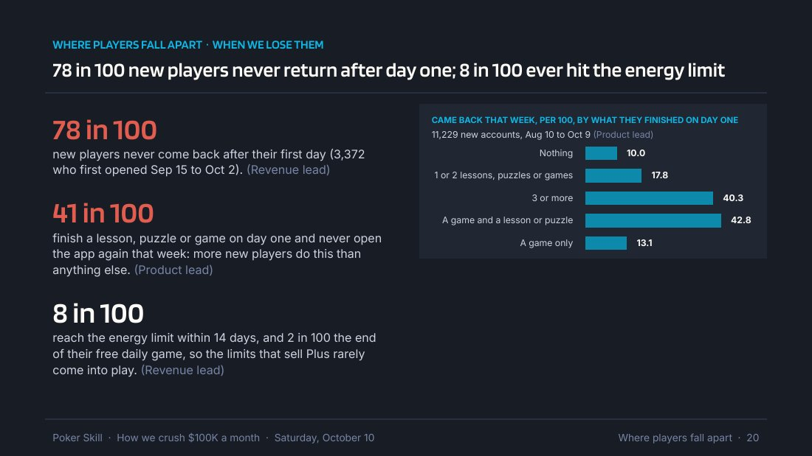
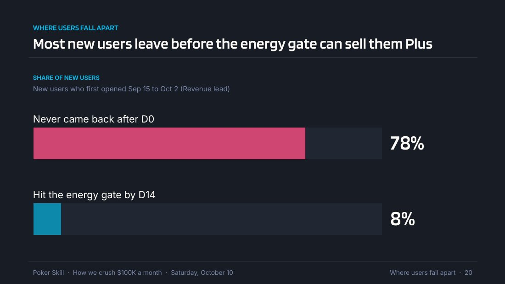
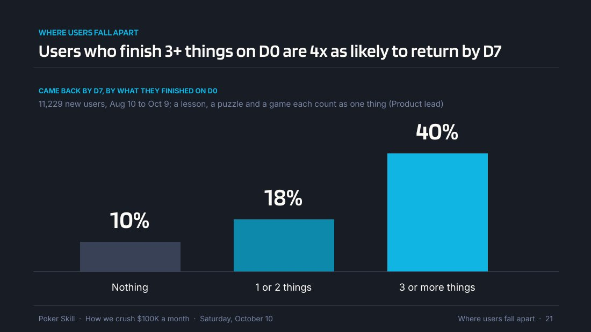
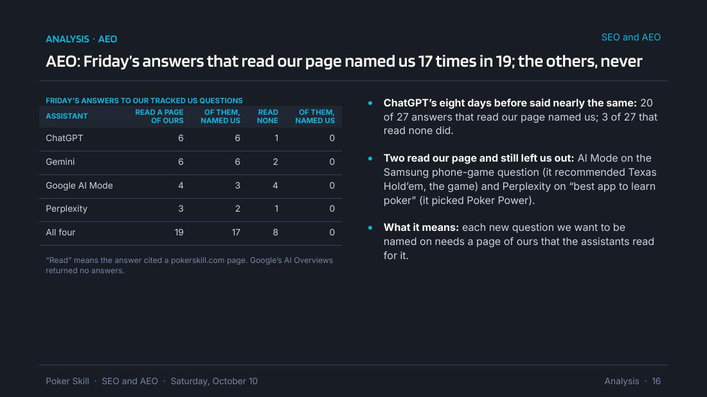
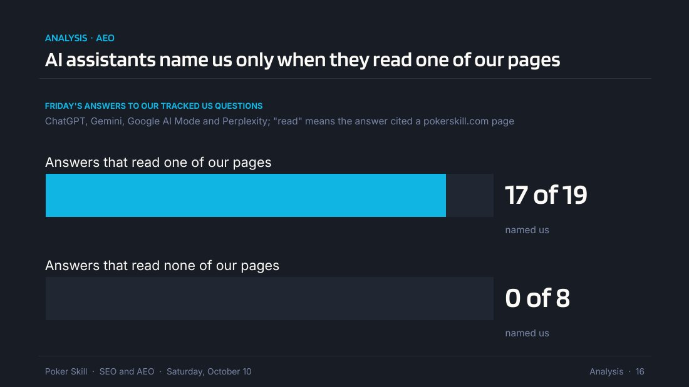
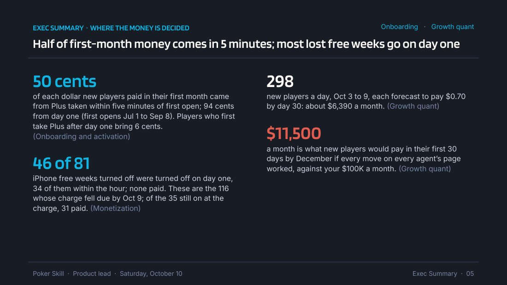
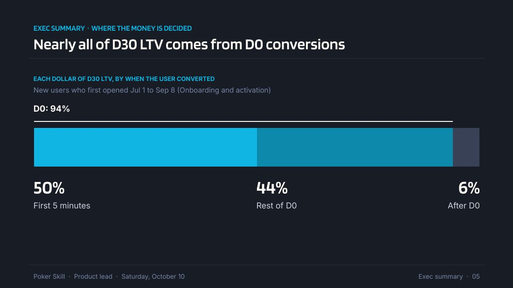
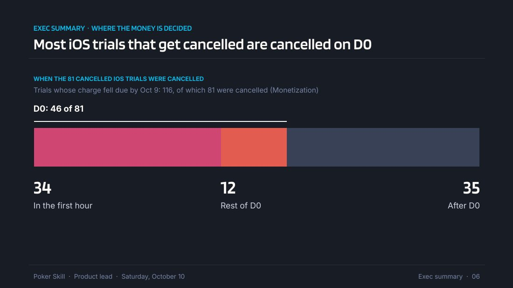
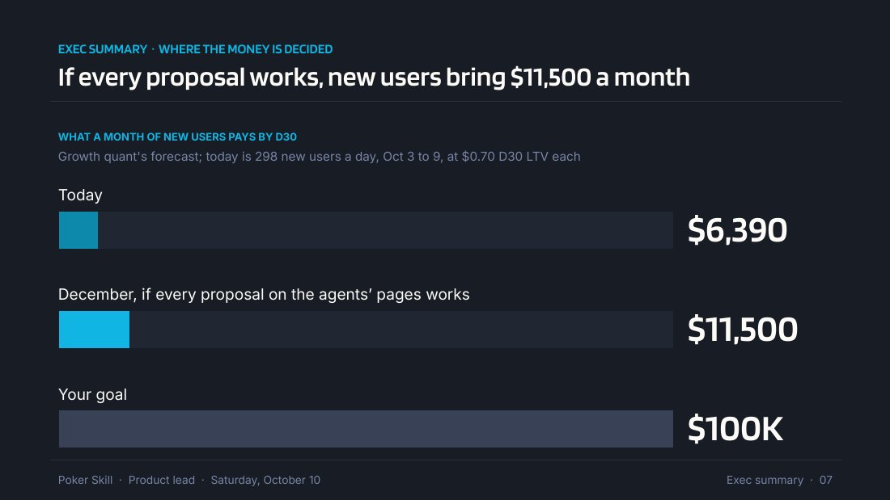

# Bad and good slides, as pictures

Each pair below is a real slide an agent built for one of Amir's morning
decks, and the version he approved. Open every image with your image-viewing
tool: what you are learning is what a slide with one thing on it looks like,
and the words cannot show that. Each image's headline is written out under it
for when an image cannot be opened.

What to see in every good slide:

- The headline is the one thing. Read alone, it tells him the point.
- Under it, one short line says who is counted and when, then the picture.
  There is no paragraph anywhere on the slide.
- Every number in the picture has its unit and its comparison.
- His words: users, trial, energy gate, iOS, D0, D7, D30, %, proposal.
- Where the bad slide held several things, the good version is more slides,
  not smaller type.

## 1. Two findings and a chart become two slides

**Bad.** "How we crush $100K a month", slide 20.

Headline: "78 in 100 new players never return after day one; 8 in 100 ever hit
the energy limit". Under it, three big numbers, each over a paragraph, and a
five-bar chart. The slide's real point is the last clause of the third
paragraph: "so the limits that sell Plus rarely come into play". The chart is
a third finding. "In 100", "players", and "energy limit" are the agent's
words, not his.

**Good, slide 1 of 2.**

Headline: "Most new users leave before the energy gate can sell them Plus".
Two bars against 100%: 78% never came back after D0; 8% hit the energy gate
by D14.

**Good, slide 2 of 2.**

Headline: "Users who finish 3+ things on D0 are 4x as likely to return by D7".
Three columns in order: nothing 10%, one or two things 18%, three or more 40%.
The bad slide's five overlapping bars became three. Its second number ("41 in
100 finish one thing on day one and never come back that week") was dropped,
because this slide already makes that point.

## 2. The headline was the evidence, not the point

**Bad.** SEO and AEO morning deck, slide 16.

Headline: "AEO: Friday's answers that read our page named us 17 times in 19;
the others, never". The second half drops its verb, so he rebuilds it from
the first. A table by assistant and three bullets sit under it, and what it
means is the last bullet: "each new question we want to be named on needs a
page of ours that the assistants read for it".

**Good.**

Headline: "AI assistants name us only when they read one of our pages". Two
bars: answers that read one of our pages, 17 of 19 named us; answers that read
none, 0 of 8. The table by assistant, the week before, and the two exceptions
went to the speaker notes.

## 3. Four findings become three slides

**Bad.** The product lead's morning deck, slide 5.

Headline: "Half of first-month money comes in 5 minutes; most lost free weeks
go on day one". Four big numbers, each over a 25 to 35 word paragraph. Each
number is its own finding. "Money comes in 5 minutes" is compressed: he has to
work out who did what.

**Good, slide 1 of 3.**

Headline: "Nearly all of D30 LTV comes from D0 conversions". One bar split by
when the user converted: first 5 minutes 50%, the rest of D0 44%, after D0 6%.

**Good, slide 2 of 3.**

Headline: "Most iOS trials that get cancelled are cancelled on D0". One bar of
the 81 cancelled trials: 34 in the first hour, 12 in the rest of D0, 35 after
D0.

**Good, slide 3 of 3.**

Headline: "If every proposal works, new users bring $11,500 a month". Three
bars: today $6,390, December with every proposal working $11,500, his goal
$100K. The bad slide's last two numbers were one comparison, so they share a
slide. Its first try, "...$11,500 a month by December", ran past one line at
22 points, so "by December" moved into the bar's label.
